## 🖥️ whoami

```bash
$ whoami
ariel — full stack software engineer

$ tail -f ~/work.log
[back]  designing APIs and services that stay clean at scale
[front] crafting interfaces that feel effortless to use
[mob]   shipping apps that live on your phone and your desk
[goal]  scalable & maintainable — always learning what comes next
[life]  🐈 cat owner  ·  🎧 always listening to music  ·  😎 chill guy

$ ping socials
```

<div align="center">
  <a href="https://linkedin.com/in/lazarito444"></a>
  <a href="https://instagram.com/@LazaDev_"></a>
  <a href="https://www.youtube.com/@LazaDev"></a>
</div>

## 📊 Contribution Graph


<div align="center"><strong>· languages ·</strong><br><br>

</div>

<div align="center"><strong>· frameworks ·</strong><br><br>

</div>

<div align="center"><strong>· data, cloud & tools ·</strong><br><br>

</div>

## 🚀 Featured Projects

| | Project | About | Stack |
|:--|:--|:--|:--|
| 💸 | [**ExpenseLab**](https://github.com/Lazarito444/ExpenseLab) | Mobile-first personal finance — income, expenses, savings & budgets with clear insights | `Flutter` `Drift` |

## 💭 Dev Quote

<div align="center"></div>

## 🐍 Snake

<div align="center"></div>


